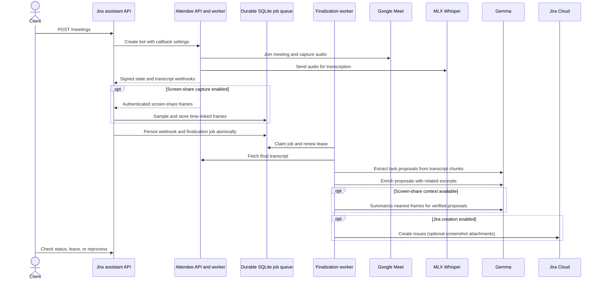

# Google Meet to Jira task assistant

This service joins a Google Meet with a locally hosted Attendee bot. Attendee sends meeting audio to local MLX Whisper for transcription; a local Gemma model then identifies explicit action items, which are stored in SQLite. Screen-share context is optional and disabled by default. Jira issue creation is off by default; proposals remain in `dry_run` for review until `JIRA_DRY_RUN=false`.

## Pipeline

1. `POST /meetings` creates an Attendee bot and configures `bot.state_change` and `transcript.update` callbacks. When optional Google Calendar auto-join is enabled, the API polls the configured recurring event and calls the same bot-creation flow shortly before it starts.
2. Attendee sends MP3 audio segments to the local MLX Whisper service through its `custom_async_v2` provider and emits signed transcript webhooks. Webhooks are verified and deduplicated; utterances are persisted as they arrive. If `SCREENSHARE_CAPTURE_ENABLED=true`, Attendee also streams screen-share-only JPEG frames to an authenticated websocket. The API samples and stores frames with estimated meeting-relative timestamps.
3. On `post_processing_completed`, the API atomically records the signed webhook and a finalization job in SQLite. A separate worker fetches the canonical locally generated transcript from Attendee and extracts task proposals in chunks. For each proposal, Gemma reviews a bounded transcript window and keyword matches; nearby screen-share frames can add visual context, but cannot create a task or set its owner. Duplicate webhook deliveries are ignored.
4. High-confidence tasks with a verified spoken task quote are saved alongside assignment evidence, transcript excerpts, and time-linked visual evidence. Jira receives visual summaries; JPEG attachments are a separate opt-in via `JIRA_ATTACH_SCREENSHARE_EVIDENCE`. Jira issue creation is attempted only when dry-run is disabled and Jira credentials are configured.

Attendee owns the meeting-bot lifecycle and audio capture. This service's API is the Jira assistant's workflow API: it delegates bot operations to Attendee, receives callbacks, and coordinates task extraction and Jira issue creation.



The transcript, extracted-task records, cited context excerpts, sampled screen-share JPEGs, and durable job queue are stored in SQLite at `DATABASE_PATH`, shared by the API and worker. Screen frames expire after 24 hours by default; the worker removes expired rows periodically. The authenticated `GET /meetings/{bot_id}/screen-frames/{frame_id}` endpoint serves retained frames. On startup, both processes apply unapplied, versioned schema migrations in order. Jobs are leased; transient failures retry with capped exponential backoff, honoring `Retry-After`, until connectivity returns, and expired leases are reclaimed. Permanent failures are surfaced instead of retried. Ambiguous Jira create outcomes remain `uncertain` rather than being retried automatically, to avoid duplicate issues. This protects work across process and container restarts on the same host; it is not a substitute for off-host backups or a replicated production database. Transcript and optional image inputs are sent to the configured OpenAI-compatible model endpoint, which should remain local for sensitive meeting data. Jira receives accepted task fields, a context-rich description, separate task and assignment quotes, cited transcript excerpts, visual summaries, and the meeting link when issue creation is enabled. If screenshot attachments are enabled, Jira retains a separate copy under its own retention policies.

### Operating on unstable networks

Finalization jobs stay in SQLite while transient dependency failures are retried. The [pipeline](./app/pipeline.py) reuses a locally saved final transcript on retry, and the [task extractor](./app/integrations/task_extraction.py) checkpoints each completed transcript chunk and task-context result, so a retry resumes at the first incomplete model call. The default Attendee and model endpoints are local; Google Meet and Jira Cloud still require network access. Jira creation is automatically retried only when the request was not sent (connection failure) or Jira explicitly rate-limited it. A timeout after sending or a server error can mean Jira created the issue, so the task remains `uncertain` and must be checked before retrying. Bot creation is also a non-idempotent external request and is not blindly retried. A finalization webhook that never reaches the service can still prevent a job from being queued; completion recovery currently depends on Attendee's webhook-delivery behavior.

The local model defaults to a 16,384-token context, controlled by `LLM_CONTEXT_TOKENS`; `scripts/dev.py` passes the same value to vLLM. The API caps generated output with `LLM_MAX_COMPLETION_TOKENS` (default 2,048) and reserves context headroom. Prompt sizing uses conservative UTF-8 byte estimates rather than a Gemma tokenizer in the API container. Transcript chunks are split at utterance/sentence boundaries, context excerpts are ranked and compacted, and model-reported context overflows trigger further splitting or compaction. Set both values to match the model server's configured context; the example values are in [`.env.example`](./.env.example).

## Requirements and setup

- macOS 15 or later on Apple Silicon.
- Docker Desktop with Docker Compose v2.20.3 or later. Compose runs the API, durable-job worker, and Attendee development stack together; the API image uses Python 3.14 and locked dependencies.
- [uv](https://docs.astral.sh/uv/getting-started/installation/) for local development.
- vLLM-Metal installed in its managed native arm64 Python 3.12 environment.
- The MLX Whisper transcriber runs natively on Apple Silicon with Python 3.14 and `ffmpeg`.
- The Attendee source checkout at `../attendee`. Recording storage runs in local RustFS; AWS credentials are not needed.
- An Attendee API key and webhook secret created in the local Attendee instance.
- A long random `MLX_TRANSCRIBER_API_KEY`, shared by the API and the local transcriber.
- No public callback URL is needed with the local Attendee stack for audio-only meetings; it reaches the API at `http://api:5005` over the shared Compose network. The local Compose override permits this internal HTTP callback. Screen-share streaming additionally requires `APP_PUBLIC_URL` to be a public HTTPS URL because Attendee requires a `wss://` endpoint; use a public HTTPS tunnel when enabling capture, including with the local Attendee stack.
- Jira Cloud API credentials only when enabling issue creation.

```sh
cp .env.example .env
```

## Enable automatic Google Calendar join requests

Auto-join is disabled by default. To enable it, create a Google Cloud OAuth desktop client, enable the Google Calendar API, and grant the read-only `calendar.events.readonly` scope. Put the client ID and secret in `.env`, then run the local consent helper:

```sh
uv run --no-active --group dev python -m scripts.google_calendar_auth
```

The helper opens Google consent in your browser and prints a refresh token. Keep it private and add it to `.env` as `GOOGLE_CALENDAR_REFRESH_TOKEN`. Configure the event filter and enable the feature:

```dotenv
GOOGLE_CALENDAR_AUTO_JOIN_ENABLED=true
GOOGLE_CALENDAR_ID=primary
GOOGLE_CALENDAR_EVENT_TITLE=Daily Product Sync
GOOGLE_CALENDAR_ORGANIZER_EMAIL=organizer@example.com
GOOGLE_CALENDAR_TIME_ZONE=America/Los_Angeles
GOOGLE_CALENDAR_START_TIME=10:00
```

The organizer filter is optional but recommended. The API polls upcoming calendar occurrences, selects only an exact title match at the configured local time with a valid Google Meet link, and requests the Attendee bot five minutes before start (with a two-minute late grace period). Canceled events and events without a Meet link are skipped. Google also offers [push notifications](https://developers.google.com/workspace/calendar/api/guides/push), but those signal calendar changes rather than meeting start times and require a publicly reachable HTTPS webhook; this local Compose setup uses polling. The event occurrence is recorded before the external bot request; an uncertain request is not retried automatically to avoid duplicate bots. Inspect recent attempts at `GET /calendar/auto-join` with the app bearer token. A host may still need to admit the bot.

Project dependencies are declared in `pyproject.toml`; `uv.lock` records the resolved versions. For local development, run `uv sync --no-active --group dev` to create the project `.venv` and install the local MLX Whisper service package into that same environment.

## Configure Attendee locally

Attendee's upstream development stack is included in this project's Compose configuration. The API, Attendee API, worker, scheduler, Postgres, Redis, and RustFS recording storage start and stop together. The API reaches Attendee over the Compose network; Attendee's API and worker both receive the custom transcription URL, and the worker sends MP3 audio segments to MLX Whisper on the Mac at `host.docker.internal:8101/transcribe`. MLX Whisper uses `ffmpeg` to decode and resample each segment. Gemma uses port `8100`.

The local Compose override adds `attendee-app-local` to Attendee's Django `ALLOWED_HOSTS`, so requests from the API container are accepted by Django.

Clone Attendee next to this repository once, then generate its development environment file:

```sh
git clone https://github.com/attendee-labs/attendee.git ../attendee
docker compose build attendee-app-local
docker compose run --rm -T attendee-app-local python init_env.py > ../attendee/.env
```

Build the image in a separate step; redirecting the `run` output to a file while the image still has to be built makes Docker's build progress writer fail with `failed to get console: provided file is not a console`.

No AWS configuration is needed. Compose creates the `attendee-recordings` bucket in RustFS and supplies Attendee with local-only credentials and the RustFS endpoint. The RustFS console is available at `http://localhost:9001` with access key `ATTENDEELOCAL` and secret key `attendee-local-development`. The S3 API is also available at `http://localhost:9000` from the host. Attendee recordings persist in the `attendee_storage_data` Docker volume. The `scripts/dev.py` launcher starts the native model servers and this Compose stack together; start it after configuring the local Gemma environment below.

## Run the complete local stack

MLX Whisper and vLLM-Metal need the macOS Metal runtime. Docker Desktop runs containers inside Linux, and MLX's Linux backend is CPU-only; the model servers therefore run natively while the API and Attendee services run in Compose. The local Whisper package shares the project's Python 3.14 `.venv`; the vLLM-Metal installation keeps its own Python environment. The launcher brings up both native servers and the full Compose stack with one command.

Install `ffmpeg`, set `MLX_TRANSCRIBER_API_KEY` in the project `.env`, and install vLLM-Metal if it is not installed yet:

```sh
brew install ffmpeg
curl -fsSL https://raw.githubusercontent.com/vllm-project/vllm-metal/main/install.sh | bash
```

See the [vLLM-Metal installation guide](https://docs.vllm.ai/projects/vllm-metal/en/stable/installation/) for platform requirements and the [supported-model list](https://docs.vllm.ai/projects/vllm-metal/en/stable/supported_models/) for Gemma 4 support.

For the local Attendee stack, set `APP_PUBLIC_URL=http://api:5005`; the services share a Docker network, so Attendee can post callbacks directly to the API without a public tunnel. The Compose override disables Attendee's HTTPS-only webhook URL check for this local stack. If you use a hosted Attendee instance, set `APP_PUBLIC_URL` to a public HTTPS tunnel URL instead. Choose a long random `APP_API_TOKEN`. Docker Compose passes `.env` to the API container at runtime; it is excluded from the image build. The API's SQLite database is stored in a persistent Docker volume. The first Whisper transcription downloads the model selected by `MLX_WHISPER_MODEL`; it defaults to `mlx-community/whisper-turbo`.

### Optional screen-share context

Screen capture is disabled by default. Enable it only when the meeting participants have been informed and the applicable recording and screen-capture permissions are in place. Set `SCREENSHARE_CAPTURE_ENABLED=true` and provide a random `SCREENSHARE_WEBSOCKET_TOKEN` of at least 32 characters. Also set `APP_PUBLIC_URL` to a public HTTPS endpoint or tunnel: Attendee requires `wss://` for video, even when the rest of the local setup uses internal HTTP. The Attendee bot then streams screen-share frames only (no webcams) over the API websocket. Sampling defaults to one stored frame every 10 seconds at 360p, with a 600-frame per-meeting cap and a 24-hour retention period; adjust these using the `SCREENSHARE_*` settings in [`.env.example`](./.env.example).
Attendee's current screen-frame event does not include a media timestamp. The service estimates meeting-relative time using the recording-start webhook and frame receive time (or first-frame receive time as a fallback), so Jira timestamps are approximate. A nearby frame is summarized by the configured model only for a task already supported by spoken transcript evidence. Keep `SCREENSHARE_VISION_ENABLED=true` only if the configured OpenAI-compatible model accepts image inputs; visual-analysis errors do not block audio-based task creation. `JIRA_ATTACH_SCREENSHARE_EVIDENCE=true` separately uploads selected JPEGs to Jira; leave it false unless Jira is an approved storage destination for screen content. Retained frames can be inspected through the authenticated `GET /meetings/{bot_id}/screen-frames/{frame_id}` endpoint.

Activate the vLLM-Metal environment and start everything from the repository root:

```sh
source ~/.venv-vllm-metal/bin/activate
uv run --no-active --group dev python scripts/dev.py up
```

After changing the local transcriber code, restart only MLX Whisper with `uv run --no-active --group dev python scripts/dev.py restart-whisper`; this leaves the meeting bot and the other services running.

Apply Attendee's migrations, then create its local account:

```sh
docker compose exec attendee-app-local python manage.py migrate
```

Create an account at `http://localhost:8000`. Attendee prints the confirmation link in its app logs; retrieve it with `docker compose logs attendee-app-local`. After confirming, create an API key and configure the webhook secret in Attendee settings; put those values in this project's `.env` as `ATTENDEE_API_KEY` and `ATTENDEE_WEBHOOK_SECRET`.

The API is available from the host at `http://127.0.0.1:5005`; local Attendee callbacks use `http://api:5005` over Compose networking. If you connect to a hosted Attendee instance, point a public HTTPS tunnel at the host API address. Use `uv run --no-active --group dev python scripts/dev.py down` to stop the Compose stack and the native servers started by the launcher. Its native server logs are in `.dev-run/`. Docker volumes remain between restarts; `docker compose down -v` also deletes the Jira database, Attendee's Postgres data, and local recording storage.

## API

All management routes require `Authorization: Bearer $APP_API_TOKEN`. The health endpoints and signed webhook endpoint are exempt.

`GET /health` is a readiness check: it returns HTTP 503 if SQLite is unavailable or the worker heartbeat is stale. `GET /health/live` only reports whether the API process is responding. The API and job worker run as UID 65532 with read-only root filesystems, a writable `/tmp`, all Linux capabilities dropped, `no-new-privileges`, and limits of 1 CPU, 1 GiB memory, and 128 PIDs. Attendee's API, worker, and scheduler also drop capabilities and run with `no-new-privileges`; Compose bounds those services, Postgres, Redis, RustFS, and the optional webpage streamer. These are local development budgets—tune them against production workload measurements. Native Whisper and Gemma are host processes and are not constrained by Compose.

Create a meeting bot:

```sh
curl -X POST http://127.0.0.1:5005/meetings \
  -H 'Authorization: Bearer YOUR_APP_API_TOKEN' \
  -H 'Content-Type: application/json' \
  -d '{"meeting_url":"https://meet.google.com/abc-defg-hij"}'
```

Inspect status and extracted tasks using the returned `bot_id`:

```sh
curl http://127.0.0.1:5005/meetings/BOT_ID \
  -H 'Authorization: Bearer YOUR_APP_API_TOKEN'
```

Other endpoints are `POST /meetings/{bot_id}/leave` and `POST /meetings/{bot_id}/reprocess`. Reprocessing now enqueues durable work rather than running inside the API request process; completed meetings return HTTP 409, while dry-run and failed meetings can be queued again.

The meeting status endpoint includes the Attendee bot state, pipeline status, final transcript, and task proposals. Each proposal includes a context-rich description, separate task and assignment quotes, selected transcript excerpts, and any nearby screen-share frame IDs, timestamps, and summaries. Frame retrieval uses the authenticated endpoint above. A meeting in `dry_run` can be reprocessed after changing `JIRA_DRY_RUN` to `false` and restarting the API.

## Jira configuration

Keep `JIRA_DRY_RUN=true` while evaluating proposals. Once validated, configure the Jira site, email, API token, project key, and issue type, then set `JIRA_DRY_RUN=false` and restart the service. Only `Zachary` or `Zac` can be assigned, and only when that exact name appears in explicit assignment or acceptance evidence. A clear delegation to an absent teammate counts; speculation, speaker labels, pronouns, and inferred identity do not. `JIRA_SPEAKER_ACCOUNT_IDS` maps either eligible name to a Jira account ID; other owners remain unassigned. `JIRA_PRIORITY_MAP` maps model priority labels to Jira priority names. Due dates are included only when the model extracts a specific ISO date.

### Quick synthetic evaluation

A fully fictional, multi-speaker daily-sync fixture with timestamps spanning about an hour is included at `tests/fixtures/synthetic_daily_sync.json`. Zachary is absent from the speaker list; explicit teammate delegations to him are labeled as assignments, while speculative or unowned work is not. Only Zachary's tasks are in the gold set; other tasks in the meeting are distractors. Run the extractor against the configured local model without creating Jira issues:

```sh
uv run --no-active --group dev python -m scripts.evaluate_task_extraction
```

The report compares raw proposals with proposals that pass the configured confidence threshold. It matches tasks by their cited transcript segment and normalizes `Zac` to `Zachary`, so review summaries, quotes, and task duplicates manually. This is a quick smoke/regression check, not a substitute for labeled real meetings.

An issue-creation request that fails is recorded as `uncertain` so a retry does not accidentally create a duplicate issue. Inspect the meeting record and Jira before manually retrying an uncertain proposal.

## Current scope

See [plan.md](./plan.md) for the development roadmap.
